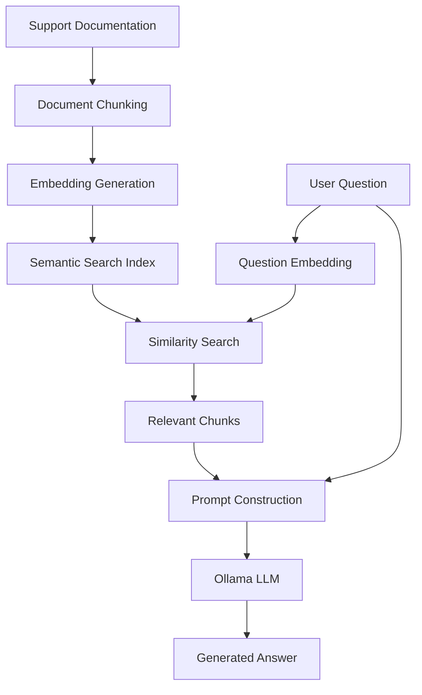

# RAG Document Assistant — C# / .NET 10 / Ollama

A hands-on AI Engineering portfolio project demonstrating how to build a Retrieval-Augmented Generation (RAG) application using C# and .NET 10 with locally hosted language models.

The application retrieves relevant information from technical documentation using semantic search and generates context-grounded answers with a local Large Language Model (LLM).

The project focuses on understanding and implementing the core components of a RAG pipeline, including document chunking, embeddings, vector similarity search, prompt engineering, and automated evaluation.

## Features

- **Document ingestion:** Loads technical support documentation from local text files.
- **Text chunking:** Splits documents into smaller sections for more effective retrieval.
- **Embedding generation:** Generates vector embeddings using Ollama and `all-minilm:latest`.
- **Semantic search:** Uses cosine similarity to identify relevant document chunks.
- **Configurable retrieval:** Supports a relevance threshold and configurable Top-K retrieval.
- **Context-grounded generation:** Uses `qwen2.5:3b` to generate answers based on retrieved document context.
- **Insufficient-context handling:** Avoids LLM generation when no relevant chunks are retrieved and instructs the model to acknowledge missing information.
- **RAG evaluation:** Runs predefined test cases to evaluate retrieval results, generated answers, and appropriate abstention when information is unavailable.
- **Evaluation reporting:** Displays retrieved chunks, generated answers, errors, and overall test results.

## Architecture

The application follows a straightforward RAG pipeline:



## How It Works

1. Load the technical support guide from a local text file.
2. Split the document into smaller chunks.
3. Generate embeddings for each chunk using Ollama.
4. Generate an embedding for the user's question.
5. Calculate cosine similarity between the question and document embeddings.
6. Retrieve the most relevant chunks based on the configured threshold and Top-K value.
7. Pass the question and retrieved context to the LLM.
8. Generate and display a context-grounded answer.

If no relevant chunks are retrieved, the application skips LLM generation and reports that the information is unavailable in the provided context.

## RAG Evaluation

The project includes a basic automated evaluation component with predefined test cases.

The evaluation checks:

- Whether relevant information is retrieved.
- Whether retrieved chunks contain expected keywords.
- Whether generated answers contain expected keywords.
- Whether the model correctly abstains when the answer is unavailable in the context.

The current evaluation uses keyword-based checks and phrase-based abstention detection. These are lightweight evaluation methods and do not yet measure semantic answer quality.

### Current Evaluation Results

| Metric | Result |
|---|---:|
| Total test cases | 3 |
| Passed | 3 |
| Failed | 0 |
| Success rate | 100% |

These results reflect the current predefined test cases, not general model accuracy.

## Technology Stack

- **Language:** C#
- **Framework:** .NET 10
- **LLM Runtime:** Ollama
- **Embedding Model:** all-minilm:latest
- **Chat Model:** qwen2.5:3b
- **HTTP Communication:** System.Net.Http
- **JSON Processing:** System.Text.Json

## Example Questions

The current support guide covers database troubleshooting scenarios.

Examples:

- What should be checked when a database connection timeout occurs?
- What should be checked when authentication fails?
- Why might a user receive an access denied error?
- How can I reset a forgotten database password?

The last question is intentionally unanswerable using the current document, allowing the evaluation to test whether the system correctly abstains.

## Prerequisites

- .NET 10 SDK
- Ollama installed and running
- The required Ollama models

Download the models:

```bash
ollama pull all-minilm
ollama pull qwen2.5:3b
```

Make sure Ollama is available at:

```text
http://localhost:11434
```

## Run Locally

Clone the repository:

```bash
git clone https://github.com/FatimaDavoudi/dotnet-rag-document-assistant.git
```

Navigate to the project directory:

```bash
cd dotnet-rag-document-assistant
```

Restore dependencies:

```bash
dotnet restore
```

Start the application:

```bash
dotnet run
```

## Application Commands

The application provides an interactive terminal interface.

- Enter a question to query the document assistant.
- Enter `test` to run the RAG evaluation.
- Enter `exit` to close the application.

## Current Limitations

- Document ingestion currently supports plain-text files.
- Chunking uses a simple strategy tailored to the current documentation.
- Retrieval quality depends on the embedding model, chunking strategy, and relevance threshold.
- Evaluation is currently based on keyword matching and phrase detection.
- Prompt instructions can reduce hallucinations but cannot guarantee factual correctness.
- The project uses a small local document collection and is not designed for production deployment.

## Future Improvements

- Semantic evaluation of generated answers.
- Source citations and document references in responses.
- Support for additional document formats such as PDF and DOCX.
- ASP.NET Core Web API integration.
- Improved logging and monitoring.
- AI agent integration with controlled tool calling.
- Human approval workflows for sensitive operations.

## Project Goals

This project was developed to gain practical experience in AI Engineering, particularly:

- Integrating locally hosted LLMs into .NET applications.
- Understanding embeddings and semantic search.
- Implementing a complete RAG pipeline.
- Designing context-grounded prompts.
- Evaluating retrieval and generation quality.
- Handling insufficient context and model availability.

## Author

Developed as a practical AI Engineering portfolio project using C#, .NET 10, and Ollama.